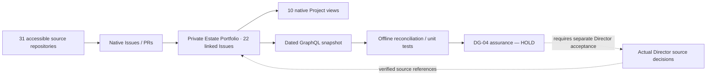

# Estate Operations Dashboard — source-backed snapshot (2026-11-03)

**Status:** WP04 implementation candidate, not DG-04 accepted. **Security:** PRIVATE FFOS. [Live operational Project](https://github.com/orgs/Motherpher/projects/2). [Exact data snapshot](data/portfolio-snapshot-2026-11-03.json). This markdown is a **post-verification snapshot** (WP04 moved to Verification), not a live connected dashboard. See [adoption register](ADOPTION-REGISTER-v1.md) for all 31 accessible repositories. GitHub Projects' 10 verified saved views remain the interactive management surface.

## Overview

| Metric | Observed value |
|---|---:|
| Linked Project Items | 22 |
| Distinct linked source repositories | 12 |
| GitHub owners in portfolio | 2 |
| Open source Issues | 22 |
| Source Issues in other states | 0 |

**Important:** These 22 Project items were **selectively** linked, not imported as all current Issues or all active work. Source Issue OPEN/CLOSED and Project Work Stage do not establish technical completion or Director acceptance.

## Work by programme

| Programme | Project items |
|---|---:|
| Products & Platforms | 10 |
| FFOS | 6 |
| FFC | 2 |
| Pius | 2 |
| Conductellence / CDX | 1 |
| Research & Delivery | 1 |

## Operational stage

| Stage | Project items |
|---|---:|
| Intake | 11 |
| Blocked | 7 |
| Verification | 2 |
| Accepted | 2 |

## Authority gate

| Authority Gate | Project items |
|---|---:|
| Pending Verification | 17 |
| Require Human | 2 |
| Approved (Source Recorded) | 2 |
| Not Required | 1 |

## Evidence and operating flow (not an authority hierarchy)

**Actual operations:** source links, private Project, saved views, manual issue intake and offline snapshot validation. **Not implemented:** automatic cross-owner write synchronisation, self-acceptance, runtime policy enforcement or live performance telemetry.

## Risk/Decision queue — operational use

- [Director Decisions](https://github.com/orgs/Motherpher/projects/2) — use saved view and source Issue decisions; Project fields never authorise actions.
- [Risks & Blockers](https://github.com/orgs/Motherpher/projects/2) — review blocker evidence and dependencies.
- [Verification Queue](https://github.com/orgs/Motherpher/projects/2) — check real tests and evidence before a release.
- [Work Order WP04](https://github.com/Motherpher/FFOS/issues/46) — current programme control.
- [DG-03 accepted WP03](https://github.com/Motherpher/FFOS/issues/45) — prior documented decision.

## Data provenance and limits

1. Counts computed from the authenticated GitHub Projects V2 item API at the exact date above. No costs, usage rates, actual runtime connectivity or productivity improvement are computed.
2. **Source freshness:** each item retains `source_updated_at` in the JSON; no continuous polling or real-time connection is asserted.
3. **Privacy:** do not publish the captured private Project data. This dashboard remains in the private FFOS review branch pending DG-04.
4. **Denominators:** Project metrics use 22 selected items; adoption coverage uses 31 accessible repositories, not 31 Project-linked repositories.
5. **Reconciliation:** rerun an authorised read, compare stable Issue URL/node IDs and fields; never use an out-of-date snapshot to close work or certify a system.

## Automation and release

- GitHub Project `Auto-close issue` must remain OFF; current captured status: **OFF**.
- `Item closed` and `Pull request merged` may still change planning status, not Director authority.
- Read-only synchronized reporting and cross-owner automation require additional token and permission controls; nothing here enables them.

**No fictional zeroes:** absent measurement is marked NOT MEASURED, not 0.
