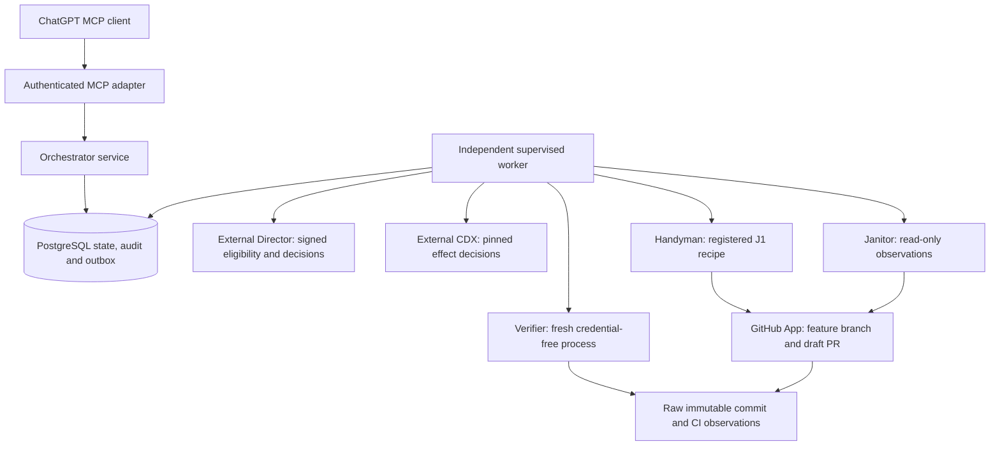

# Architecture and implemented boundaries

Household Family is Agent Stable **Agent #2** implemented as an FFOS module; it is not a sovereign agent platform. The existing FFOS object chain and domain ownership remain canonical. Household detail states map to generic FFOS run states without rewriting the shared model (Motherpher, 2026a).



## State and concurrency

`ELIGIBLE → LEASED → INSPECTING → EXECUTING → VERIFYING → READY_FOR_DIRECTOR → ACCEPTED → RECORDED` is the regular lifecycle. `REPAIRING` requires a registered J1 recipe and a bounded attempt count, followed by fresh verification. `RECOVERY_CHECK` revalidates Director authority and reconciles external branch state. `BLOCKED`, `HOLD_HUMAN`, `CANCEL_REQUESTED`, `STOPPED` and `FAILED` remain distinct. No normal-language completion statement changes state.

PostgreSQL and SQLite adapters expose one transactional SQL interface. A global PostgreSQL advisory transaction lock serializes state changes across replicas; SQLite uses `BEGIN IMMEDIATE` and WAL. This deliberately favors inspectable correctness over high throughput for a small control-plane service. Transactions remain short and never enclose HTTP calls. Project concurrency limits and one unique `(project_id, wp_id, wp_version)` run prevent duplicate logical execution.

The queue is the durable `hf_jobs` table. A worker claims an expiring fenced lease, advances one bounded stage and releases it. Crash recovery identifies expired ownership and rechecks authority before continuing. A cancellation can be requested while a write is in flight; only `STOPPED` confirms that the worker has crossed the no-new-effects boundary. Expired cancellation leases are recovered directly to `STOPPED`.

## Writes, audit and progression

The operation ledger records intent before an external write and a receipt only after read-back. Branch names and commit recipe identities are deterministic. If a response is lost, the adapter re-reads exact registered contents/diff before deciding whether the intended write already occurred. Uncertain or conflicting external state is held; the service does not force-push or delete a branch to resolve ambiguity. Exactly-once _logical_ execution is supported by reconciliation and database uniqueness, not by claiming atomic transactions across GitHub and PostgreSQL.

Every transition and audit record is committed with the corresponding database change. Evidence and decision rows have update/delete rejection triggers. Audit events form a per-project SHA-256 chain. A database owner can still disable triggers; production requires a restricted application role and protected backups. This is application/database append-only evidence, not an independent notarization system.

The external Director remains outside Household Family. Signed Director decisions bind WP identity/version, eligibility revision, scope, exact commit and evidence bundle. Only the external Director key can produce them. Acceptance writes a progression outbox record in the same transaction. After the accepted run is recorded, the worker asks the current Director feed for the next eligible WP and uses an explicitly delegated automation identity. It never invents priorities, bypasses dependencies, dispatches a `PLANNED` WP, or accepts its own evidence.

Read-only diagnostics have no arbitrary command execution. Handyman only accepts declarative registered file replacements with content-digest preconditions, path guards, file/byte limits and protected-branch denial. Repository tests execute on trusted, digest-pinned GitHub Actions workflows. Verifier executes a fixed trusted evaluator in a separate Node process; it never executes repository-provided code and receives no credentials.

## Runtime maturity

The code is implemented and locally exercised; live OAuth enrollment, CDX/Director service binding, GitHub App installation and ChatGPT registration remain separate gates. Docker configuration is provided, but a successful local TypeScript test is not evidence that an image was built or an endpoint deployed.

## References

- Motherpher (2026a) _FFOS Core Object Model v0.1_. Available at: https://github.com/Motherpher/FFOS/blob/3a93eb3d7a5195232acc850c7d301bf901014306/docs/specifications/OBJECT-MODEL.md (Accessed: 28 October 2026).
- Motherpher (2026b) _FFOS Director_. Available at: https://github.com/Motherpher/form-flode/blob/1a5962b42a6f033bc932ab084a8808607cdf6266/17-ffos/director/README.md (Accessed: 28 October 2026).


## Agent Stable relationship

```text
FFOS
└── Agent Stable
    ├── AMA
    ├── Agent Mechanic
    ├── #1 MESSI
    └── #2 Household Family
         ├── Janitor
         ├── Handyman
         └── Verifier
```

Only Household Family is the first-class agent in the lower branch. Its internal roles do not have independent agent identity or lifecycle. Director remains outside Agent Stable execution and provides mandate/acceptance.
